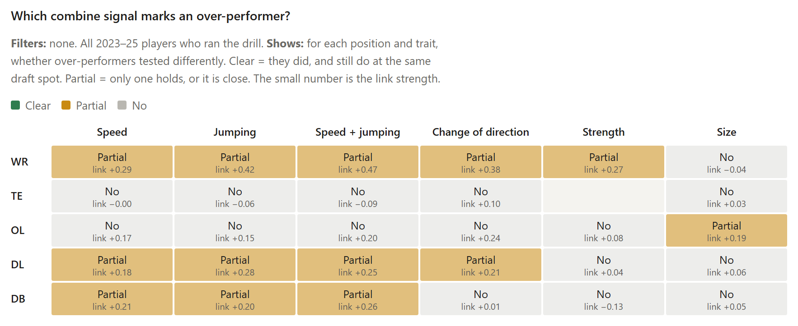
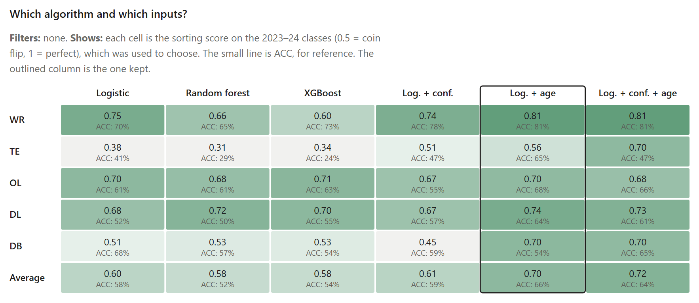
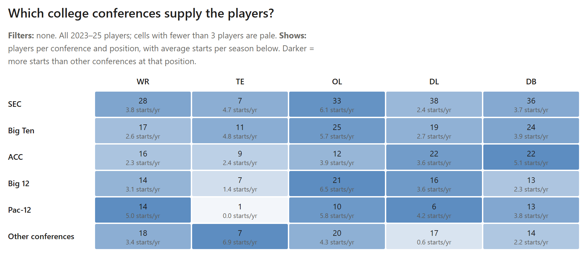

# Performance Classifier: report

**Dashboard:** https://claude.ai/artifact/FZMvRW3nZQHZsP9oYSzZnN

## 1. Question

**Can NFL Combine drills predict which rookies out-perform the typical rookie at their position? Which other factors
help?**

The forecast is meant to run **before the draft**, to help with later-round picks, so it uses only what a team knows
then.

**Answer**
- **Wide receivers: yes.** Of the 17 receivers the forecast flagged, 14 over-performed (precision 82%). ACC 81% against
  51% for guessing.
- **Age is the other factor that helps.** Over-performers were younger at every position. College conference did not
  help.
- **Other positions are weaker.** Precision is 73% for defensive line and 70% for offensive line. For tight end (55%)
  and defensive back (53%) a flag is close to a coin flip.

## 2. Terms

| Term | Meaning |
|---|---|
| Success score | Half first-season play (snaps per team game and production), half career starts per season. Each half is compared within position and draft class, so 0 is typical. |
| Over-performer | Success score above the typical rookie at his position: the median of the 2023–24 classes. 2025 uses the same line. |
| Sorting score | How often the forecast rates a random over-performer above a random under-performer (AUC). 0.5 = coin flip, 0.7 = fair, 0.8+ = good, 1 = perfect. Measured on 2023–24 and used to choose the model. |
| Precision | Of the rookies flagged as over-performers, the share who were. **The main measure:** a flag a team acts on should be right. |
| ACC | Accuracy on the 2025 class, which the forecast never saw. |
| Guessing | ACC from calling everyone the bigger group. |
| Link strength | −1 to +1 (Spearman). 0.1 weak, 0.3 moderate, 0.5 strong. |
| Same draft spot | Only players picked at about the same spot, which shows what the combine adds beyond the pick. |

## 3. Data

NFL Big Data Bowl 2027 (Kaggle). 510 players from the 2023–25 drafts: WR 107, TE 42, OL 121, DL 118, DB 122.

| File | Role |
|---|---|
| `combine_results.csv` | Forecast input: drills, weight, arm length |
| `players.csv` | Forecast input: age at the draft. Tested: college conference. Charts only: draft round and pick |
| `player_play.csv`, `games.csv` | Label only: first-season snaps and production |
| `player_career_successes.csv` | Label only: career games started |

## 4. Method

- **Combine traits:** each drill as a z-score within position and draft class, grouped into speed, jumping,
  speed + jumping, change of direction, strength and size. A missing drill counts as the class average, and the number
  of missing drills is an input.
- **Age:** years from birth to 27 April of the draft year.
- **Hypothesis tests:** Spearman, Mann-Whitney U, permutation test, and logistic regression with draft pick held fixed,
  with Holm correction.
- **Model choice:** logistic regression, random forest and XGBoost (used in the NFL Next Gen Stats draft model and in Big
  Data Bowl entries), each with and without conference and age. They were scored by sorting score in repeated 5-fold
  cross-validation on 2023–24. An input was kept only if it raised the score by more than 0.01 and did not lower ACC.
- **Kept:** logistic regression on combine results + age. A rookie is flagged when his chance is above 50%. A stricter,
  precision-first cut-off was tested and did not raise precision, so the 50% cut-off stayed.
- **Test:** trained on 2023–24, tested once on 2025.

## 5. Results

### 5.1 The approach kept


**Filters:** none. **Shows:** the label, inputs, algorithm and testing kept, with one line on why.

### 5.2 Which combine signal marks an over-performer?

**Filters:** none. All 2023–25 players who ran the drill. **Shows:** whether over-performers tested differently, by
position and trait. Clear = yes, including at the same draft spot. Partial = one of the two, or close. No = neither. The
small number is the link strength.



> WR · Jumping: Partial. Over-performers averaged +0.39 vs −0.39 for under-performers (class average = 0). At the same
> draft spot, each step above average multiplies the odds of over-performing by 2.2. 97 players.

- **Wide receivers:** jumping is the signal (link +0.42; odds ×2.2 at the same draft spot, Holm p = .054).
- **Defensive backs:** athletic players do better but are already drafted earlier.
- **Tight ends and offensive linemen:** no drill separates the groups. No cell reached Clear.

### 5.3 How well does the forecast sort the 2025 rookies?

**Filters:** none. The 2025 class only. **Shows:** real result (rows) against the forecast (columns) for each position,
then the measures. Green squares are correct.


> WR: 3 rookies were flagged as over-performers but under-performed.

| Position | Precision | Flagged and over | ACC (likely range) | Guessing | Recall | F1 |
|---|---|---|---|---|---|---|
| **WR** | **82%** | 14 of 17 | **81%** (68–92%) | 51% | 78% | 0.80 |
| DL | 73% | 11 of 15 | 64% (48–77%) | 52% | 48% | 0.58 |
| OL | 70% | 14 of 20 | 68% (53–82%) | 53% | 70% | 0.70 |
| TE | 55% | 6 of 11 | 65% (41–88%) | 59% | 86% | 0.67 |
| DB | 53% | 9 of 17 | 54% (38–70%) | 51% | 50% | 0.51 |

- **Wide receivers** are the only position whose ACC range stays above guessing.
- **Defensive line** flags are usually right, but it misses half the over-performers.
- **Tight end and defensive back** flags are close to a coin flip.

### 5.4 Which algorithm and which inputs?

**Filters:** none. **Shows:** sorting score on 2023–24 for each algorithm and input set, with ACC below. The outlined
column was kept.



> WR · Logistic regression, combine results: sorting score 0.75 on the 2023–24 classes (0.5 = coin flip). ACC 70%,
> guessing 51%.

| Model, inputs | Sorting score | ACC |
|---|---|---|
| Logistic regression, combine | 0.60 | 58% |
| Random forest, combine | 0.58 | 52% |
| XGBoost, combine | 0.58 | 54% |
| Logistic regression, + conference | 0.61 | 59% |
| **Logistic regression, + age (kept)** | **0.70** | **66%** |
| Logistic regression, + conference + age | 0.72 | 64% |

- **Logistic regression scored best.** The tree models need more players than one position offers.
- **Age helps** (0.60 → 0.70). The one exception is defensive backs, whose ACC fell from 68% to 54% with age.
- **Conference does not.** On top of age it raised the sorting score but lowered ACC, so it was left out.

### 5.5 Age at the draft

**Filters:** none. All 2023–25 players. **Shows:** median age of over- vs under-performers (dashboard text, no chart).

| | WR | TE | OL | DL | DB |
|---|---|---|---|---|---|
| Over-performers | 22.5 | 22.2 | 22.6 | 22.8 | 22.6 |
| Under-performers | 23.2 | 23.5 | 23.4 | 23.3 | 23.2 |
| Link with success | −0.39 | −0.52 | −0.47 | −0.28 | −0.37 |

### 5.6 Draft position and success score

**Filters:** position (WR shown). Drafted players only. **Shows:** each player's success score against his pick. Late
picks are the later half at that position; green dots are late picks who over-performed.


> Puka Nacua (2023, pick 177): score +2.26, 32.8 first-season snaps per team game, 14.3 starts per season. Late pick,
> over.

- Every position has late picks who beat the typical rookie. Late-pick receivers who over-performed jumped clearly
  better than their class.

### 5.7 Which athletic traits matter for career starts?

**Filters:** On its own / Same draft spot switch (both shown). Players who ran the drills. **Shows:** the link between each
trait and starts per season. Blue = better testers start more.


> TE · Speed + jumping: Among players drafted at the same spot, better testers start fewer (moderate link, −0.45).
> 35 players.

- On their own, most links are positive. At the same draft spot most disappear, because teams already draft good testers
  earlier.

### 5.8 How each round tested

**Filters:** trait (speed + jumping shown). **Shows:** each draft round's average result against its class (0 = class
average).


> WR round 7: speed + jumping below class average (−0.48)

- Speed + jumping falls from round 1 to undrafted at every position. Teams already use the combine when they draft.

### 5.9 College conferences

**Filters:** none. All 2023–25 players; cells with fewer than 3 players are pale. **Shows:** players per conference and
position, with average starts per season.



> SEC · WR: 28 players, 3.8 starts per season on average (7.3 career starts). 54% over-performed.

- The SEC supplies the most players at every position except tight end (Big Ten). More players does not mean more
  starts.

## 6. Checks

- **Success label.** Starts only and play only gave similar results (`results/label_comparison.csv`). The best result is
  WR with the kept label: ACC 81% vs 51%.
- **After the draft.** Using the real round, the forecast flagged 10 of the 29 late-round or undrafted 2025 receivers,
  and 8 of the 10 over-performed (11 of 29 overall).

## 7. Limitations

- Small 2025 groups (17–44 per position) and one test year.
- 2025 rookies have one season of starts.
- Tight-end blocking is invisible in the play data.
- The input rule looked at 2025 ACC, so 2025 results are slightly optimistic.

## 8. Conclusion

At **wide receiver**, combine results (mainly jumping) plus age pick out over-performers before the draft. Most receivers
the forecast flags do over-perform. **Age** helps at every position. At the other positions, use the forecast as a
tie-breaker at most.

## 9. Future directions

- Tight end blocking (run-blocking snaps).
- Tracked speed and acceleration in place of stopwatch times.
- The 2026 class as a second test year.
- Edge rushers and interior linemen split apart.

## 10. Reproduce

```
pip install -r requirements.txt
python src/combine_rookie_classifier.py     # downloads the data with kagglehub
python src/compare_labels.py                # success-label check
```

Add `--data-dir <folder>` to use a local copy of the data. Outputs go to `results/`.
