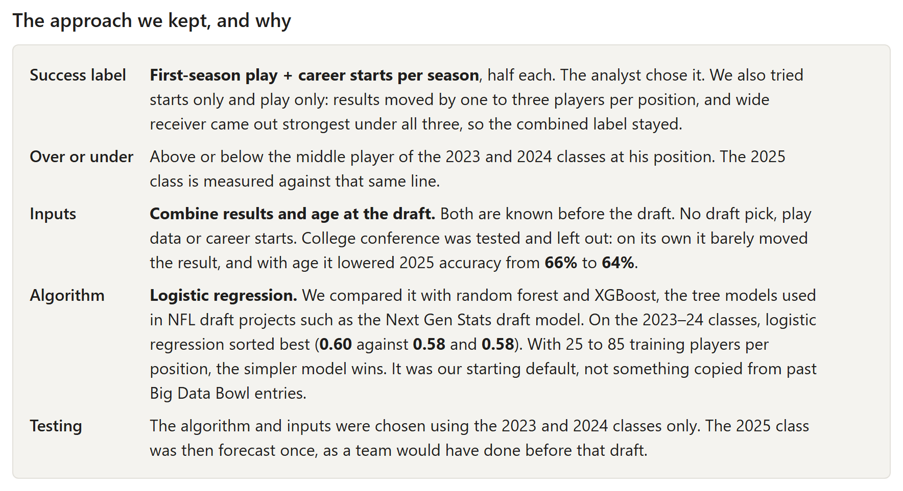
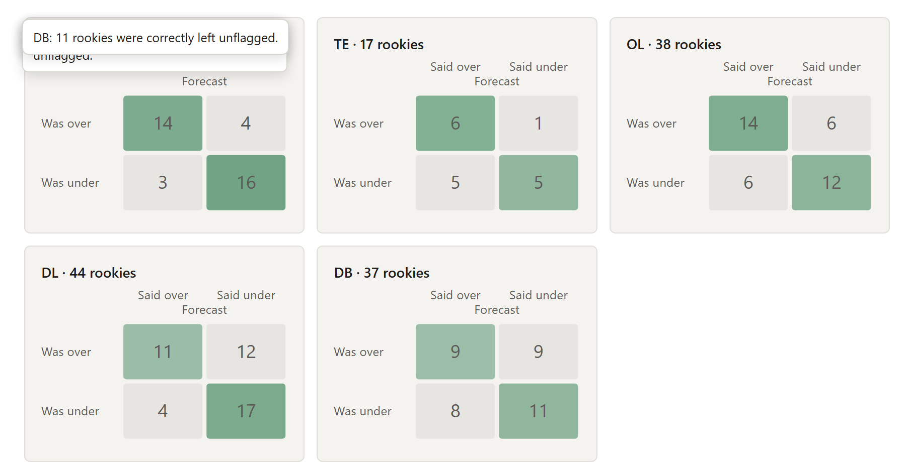
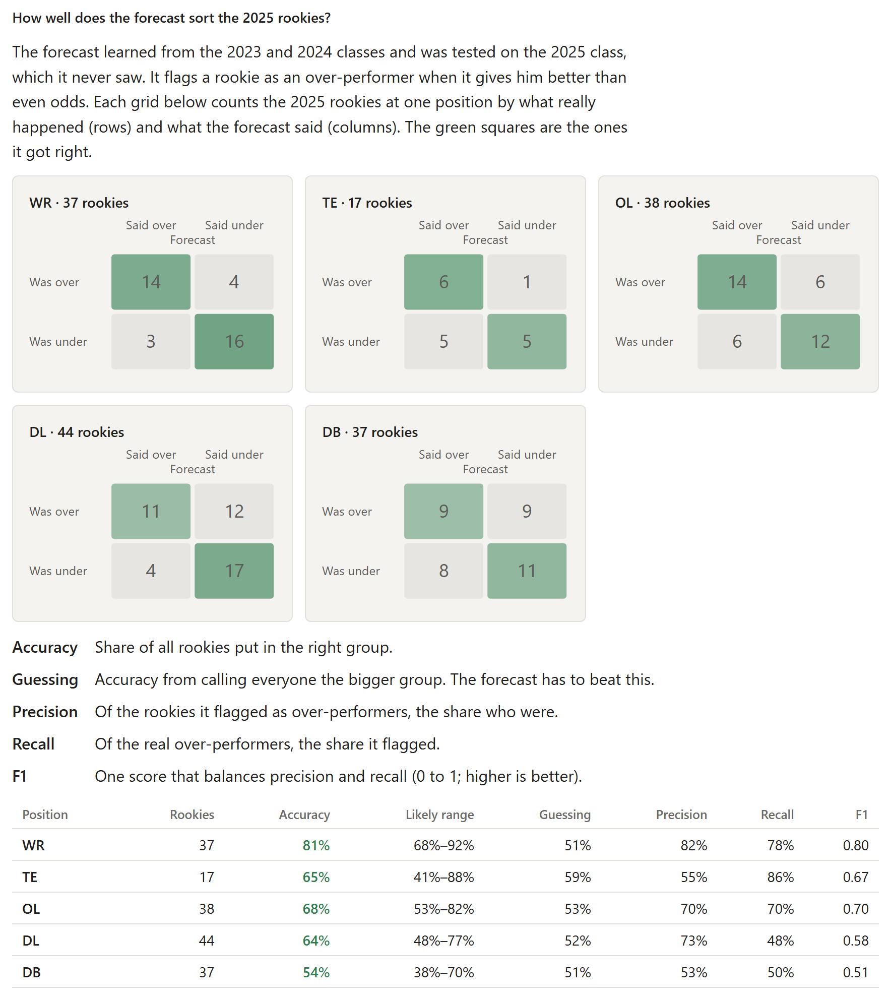
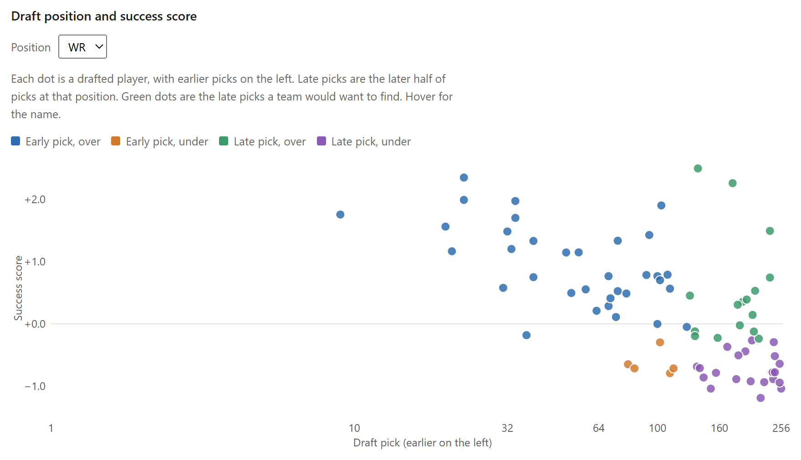
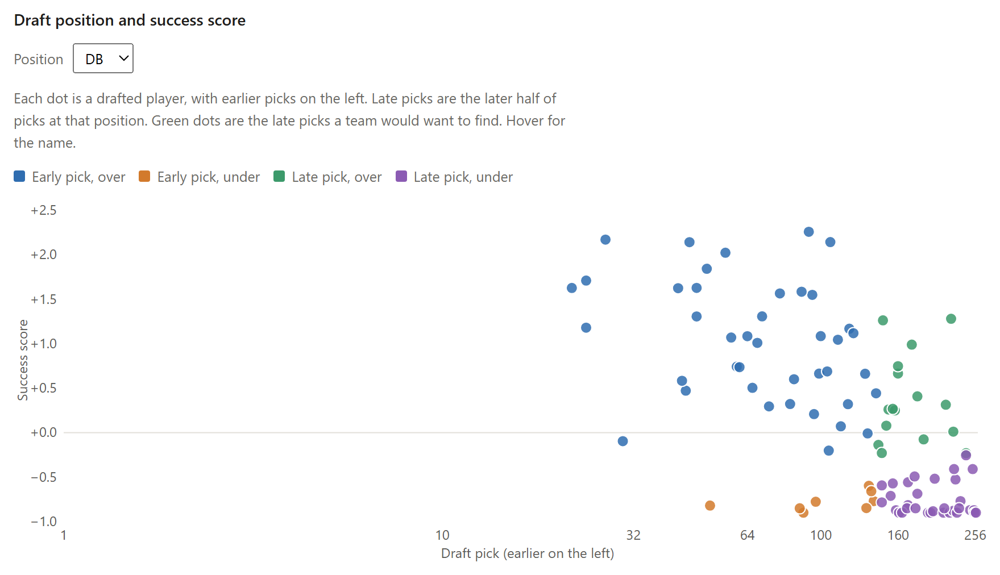
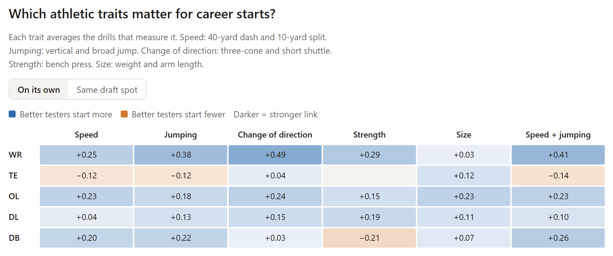
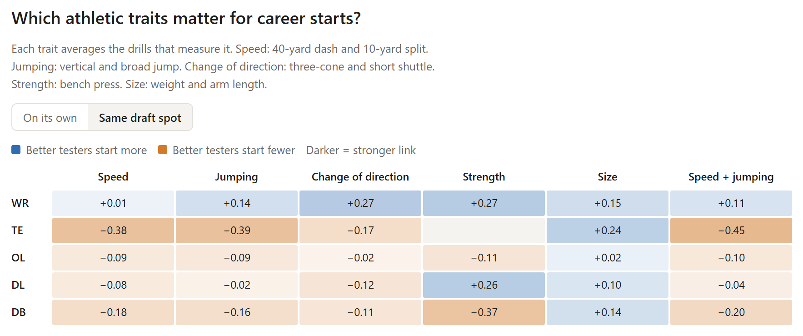
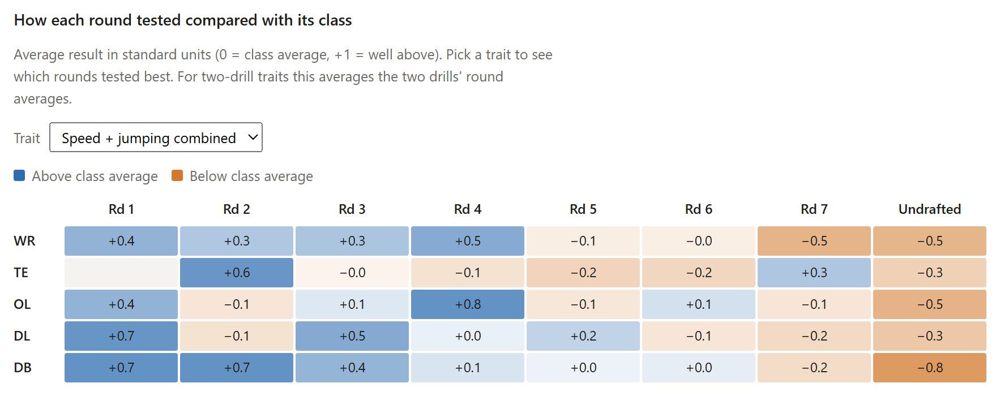
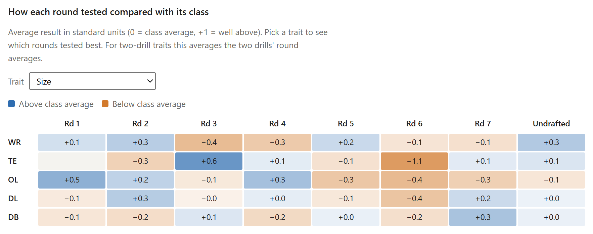

# Performance Classifier: full report

**Interactive dashboard:** https://claude.ai/artifact/FZMvRW3nZQHZsP9oYSzZnN

This report covers the whole study: the question, the data, how the forecast was built and chosen, every result with
its dashboard visual, the checks we ran, and what is left to do. Every number comes from the tables in `results/`.
Where the dashboard shows a hover note, a few notes are quoted to show how to read the chart.

---

## 1. Question and goal

**Research question.** Do NFL Combine drills predict which rookies out-perform their draft position, and does the answer
differ by position?

**Goal.** Sort a player into "likely over-performer" or "likely under-performer" **before the draft**. That helps a team
plan its later-round picks and target players who can grow into the roster. Because the forecast runs before the draft,
it may use only what a team knows then.

**Short answer**
- **Wide receiver is the clearest answer.** The forecast sorted **81%** of the unseen 2025 receivers correctly, against
  51% for guessing. The likely range (68–92%) stays above guessing. Receivers who jump better than their class are the
  over-performers.
- **Age at the draft matters more than any single drill.** At every position the over-performers were younger on draft
  day. Adding age to the combine results was the biggest improvement we found.
- **Offensive line (68%), defensive line (64%) and tight end (65%)** beat guessing, but their likely ranges reach down
  to a coin flip.
- **Defensive backs (54% against 51%)** are no better than guessing.
- **Draft position already reflects much of what the combine shows.** First-round picks test well above their class and
  undrafted players below it.

---

## 2. Data

NFL Big Data Bowl 2027 (Kaggle competition `nfl-big-data-bowl-2027`). **Scope:** 510 players from the 2023, 2024 and
2025 draft classes at five combine positions: WR (107), TE (42), OL (121), DL (118), DB (122).

| File | Used for | Role |
|---|---|---|
| `combine_results.csv` | 40-yard dash, 10-yard split, vertical, broad jump, three-cone, short shuttle, bench, weight, arm length | **Forecast input** |
| `players.csv` | Birth date (age at the draft), college conference, position, draft year | **Forecast input** (age); conference tested |
| `players.csv` | Draft round and pick (undrafted = pick 260) | Hypothesis tests and charts only, **never a forecast input** |
| `player_play.csv` | First-season snaps and production | **Label only** |
| `player_career_successes.csv` | Career games started | **Label only** |
| `games.csv` | Season and team games, for snaps per team game | Label only |

**Data limits**
- In `player_play.csv`, receivers and tight ends appear only on plays where they ran a route. Tight-end blocking counts
  only through the career-starts half of the success score.
- Many players skip drills. Only 22 tight ends ran the three-cone or shuttle, and only 11 benched. A missing drill is set
  to the class average, and the number of missing drills is itself an input.
- 2025 rookies have one season, so their starts per season come from one year.
- Age uses 27 April of the draft year as draft day (the draft is held in late April).

---

## 3. Method

### 3.1 The approach we kept, and why



| Choice | What we kept | Why |
|---|---|---|
| Success label | First-season play + career starts per season, half each | The analyst's choice. Starts only and play only were also tested (section 6); wide receiver came out strongest under all three. |
| Over or under | Above or below the middle player of the 2023–24 classes at his position | A simple, real-value line. 2025 is measured against the same line, so it is a true future test. |
| Inputs | Combine results + age at the draft | Both are known before the draft. Age was the one addition that helped. Conference did not. |
| Algorithm | Logistic regression | Best average score on the 2023–24 classes, ahead of random forest and XGBoost (section 5). It was our starting default, not something copied from past Big Data Bowl entries. |
| Testing | Choose on 2023–24, test once on 2025 | The 2025 class plays the role of a new draft the model never saw. |

### 3.2 Combine traits

Each drill becomes a z-score against the player's own position and draft class (positive = better than his class;
timed drills are flipped). Drills are averaged into six traits: speed (40, 10-yard split), jumping (vertical, broad),
speed + jumping, change of direction, strength (bench) and size (weight, arm length).

### 3.3 Success score and label (outcome only)

`success = 0.5 × z(first-season play score) + 0.5 × z(career starts per season)`

- First-season play score = 0.5 × z(snaps per team game) + 0.5 × the average z of the position's production rates:

  | Position | Production rates |
  |---|---|
  | WR, TE | targets per route, yards per route, separation, yards after catch over expected |
  | OL | pressure-allowed and sack-allowed rates (reversed), time to pressure allowed |
  | DL | pressure, sack and tackle-for-loss rates, get-off time (reversed) |
  | DB | tackle, tackle-for-loss and forced-fumble rates |

- Career starts per season = games started ÷ seasons since the draft, which keeps the three classes comparable.
- Each half is compared within position and draft class, so 0 is a typical player.
- **Over-performer** = success above the 2023–24 median at his position. The two halves agree well (Spearman
  0.69 to 0.88 by position), so the combined score is not pulling in two directions.

### 3.4 Hypothesis tests

Per position and trait: Spearman ρ with a 2,000-sample bootstrap range; Mann-Whitney U, Welch t and a 5,000-shuffle
permutation test (do over-performers test differently?); ANOVA and Kruskal-Wallis across tester thirds; logistic
regression over ~ trait + log(pick) (does the trait still matter among players drafted at the same spot?); Holm
correction across the three main traits. **Clear** = both the over/under test and the same-spot test pass;
**Partial** = one passes or both are close; **No** = neither.

### 3.5 The forecast

- **Inputs:** six combine traits, the missing-drill count and age at the draft.
- **Model:** logistic regression (standardised inputs, C = 1).
- **Choosing:** three algorithms (logistic regression, random forest, XGBoost) and four input sets (combine; + conference;
  + age; + both) were scored by 5-fold cross-validation, repeated 4 times, inside the 2023–24 classes. The algorithm
  with the best average score was kept (logistic regression unless another beat it by more than 0.01). Inputs were then
  added one at a time; an addition stayed only if it raised the average score by more than 0.01 and did not lower 2025
  accuracy.
- **Train:** 2023 and 2024 classes (25–85 players per position). **Test:** the 2025 class (17–44 per position).
- A rookie is flagged as an over-performer when the forecast gives him better than even odds.

---

## 4. Results

### 4.1 Signals of an over-performer


**How to read it.** Each cell is one position and one combine trait. The colour shows how sure we are that the trait
separates over-performers from under-performers: **Clear** (green), **Partial** (amber) or **No** (grey). The small
number is the link strength with the success score. No cell reached Clear.

**What it shows**
- **Wide receivers:** every athletic trait is Partial, and size is No. Jumping is the strongest signal (link +0.42; at the
  same draft spot each step above the class average multiplies the odds of over-performing by 2.2, Holm p = .054).
- **Defensive linemen** point the same way as receivers, but more weakly (jumping link +0.28).
- **Defensive backs:** athletic players do better, but teams already draft them earlier, so the link disappears at the
  same draft spot.
- **Tight ends and offensive linemen:** no drill separates the two groups (offensive line size is the one Partial).

**Sample hover notes**
> WR · Jumping: Partial. Over-performers averaged +0.39 vs −0.39 for under-performers (class average = 0). At the same
> draft spot, each step above average multiplies the odds of over-performing by 2.2. 97 players.

> DB · Speed + jumping: Partial. Over-performers averaged +0.19 vs −0.18 for under-performers (class average = 0). At the
> same draft spot, each step above average multiplies the odds of over-performing by 0.6. 104 players.

> TE · Speed + jumping: No. Over-performers averaged −0.11 vs +0.02 for under-performers (class average = 0). At the same
> draft spot, each step above average multiplies the odds of over-performing by 0.4. 35 players.

Both receiver and defensive back over-performers test better than their class. But at the same draft spot, receiver odds
go up (×2.2) while defensive back odds go down (×0.6): for defensive backs, the pick has already priced in the
athleticism.

### 4.2 How well does the forecast sort the 2025 rookies?





**How to read it.** Each grid counts the 2025 rookies at one position by what really happened (rows) and what the
forecast said (columns). The green squares are correct calls. The table below the grids gives five measures:

| Measure | Plain meaning |
|---|---|
| Accuracy | Share of all rookies put in the right group |
| Guessing | Accuracy from calling everyone the bigger group; the forecast has to beat this |
| Precision | Of the rookies it flagged as over-performers, the share who were |
| Recall | Of the real over-performers, the share it flagged |
| F1 | One score that balances precision and recall (0 to 1; higher is better) |

| Position | Rookies | Flagged & over | Missed | Wrongly flagged | Correctly left out | **Accuracy** (likely range) | Guessing | Precision | Recall | F1 |
|---|---|---|---|---|---|---|---|---|---|---|
| **WR** | 37 | 14 | 4 | 3 | 16 | **81%** (68–92%) | 51% | 82% | 78% | 0.80 |
| TE | 17 | 6 | 1 | 5 | 5 | 65% (41–88%) | 59% | 55% | 86% | 0.67 |
| OL | 38 | 14 | 6 | 6 | 12 | 68% (53–82%) | 53% | 70% | 70% | 0.70 |
| DL | 44 | 11 | 12 | 4 | 17 | 64% (48–77%) | 52% | 73% | 48% | 0.58 |
| DB | 37 | 9 | 9 | 8 | 11 | 54% (38–70%) | 51% | 53% | 50% | 0.51 |

**What it shows**
- **Wide receivers** are the one position where the whole likely range sits above guessing. Of the 17 receivers it
  flagged, 14 over-performed.
- **Offensive line, defensive line and tight end** beat guessing by 6 to 16 points, but their ranges reach a coin flip.
  Defensive line is cautious: when it flags a player it is usually right (73%), but it misses half the over-performers.
- **Defensive backs** sit at guessing level.

**Sample hover notes** (from the grids)
> WR: 14 rookies were flagged as over-performers and did over-perform.

> WR: 4 over-performers the forecast missed.

> WR: 3 rookies were flagged as over-performers but under-performed.

**After the draft: late-round receivers.** Using the real round, which is known only after the draft, the forecast
flagged 10 of the 29 receivers taken in round 4 or later (or undrafted), and **8 of those 10 over-performed**, against 11
of 29 for the whole group. Examples: Tez Johnson (round 7), Jaylin Lane and Dont'e Thornton (round 4), Isaiah Bond
(undrafted). At the other positions, flagged late picks over-performed 2 to 5 times out of 7 to 11.

### 4.3 Draft position and success score

The dashboard has one chart per position. **Wide receiver** and **defensive back** are shown because they tell opposite
stories about late picks. These charts use the real pick, known only after the draft.





**How to read it.** Each dot is a drafted player, with earlier picks on the left and a higher success score further up.
Late picks are the later half of picks at that position. **Green dots are late picks who over-performed.**

**What it shows**
- At both positions most over-performers are early picks, but each has late picks who beat the middle player of their
  class.
- Among late picks, **receivers** who over-performed jumped clearly better than their class. At **defensive back** it is
  the reverse: the late-pick over-performers tested less athletic.

**Sample hover notes**
> Puka Nacua (2023, pick 177): score +2.26, 32.8 first-season snaps per team game, 14.3 starts per season. Late pick,
> over.

> Elic Ayomanor (2025, pick 136): score +2.50, 26.7 first-season snaps per team game, 14.0 starts per season. Late pick,
> over.

> Roman Wilson (2024, pick 84): score −0.71, 0.1 first-season snaps per team game, 2.0 starts per season. Early pick,
> under.

### 4.4 Which athletic traits matter for career starts?





**How to read it.** Each cell is the link between a trait and career starts: blue means better testers start more,
orange means they start fewer. The second view compares only players drafted at the same spot, so it shows what the
combine adds beyond the pick.

**What it shows**
- **On their own,** most traits link with more starts at every position except tight end. Receivers show the strongest
  links (jumping +0.38, change of direction +0.49).
- **At the same draft spot,** most of those links shrink to nothing: teams already draft better testers earlier.
- **Tight ends** flip negative at the same spot: athletic tight ends start fewer games than others picked where they were.

**Sample hover notes**
> WR · Jumping: better testers start more (moderate link, +0.38). 97 players.

> WR · Jumping: Among players drafted at the same spot, better testers start more (weak link, +0.14). 97 players.

> TE · Speed + jumping: Among players drafted at the same spot, better testers start fewer (moderate link, −0.45).
> 35 players.

### 4.5 How each round tested with its class





**How to read it.** Each cell is one position and one draft round: how that round's players tested compared with their
draft class (0 = class average). Blue is above average, orange is below.

**What it shows**
- **Speed + jumping falls from early rounds to late** at every position. Teams clearly use athleticism when they draft.
- **Size has no pattern by round.**
- Since athleticism is already built into draft order, the forecast is most useful *within* a round.

**Sample hover notes**
> WR round 1: speed + jumping above class average (+0.44)

> WR round 7: speed + jumping below class average (−0.48)

> WR round 3: size below class average (−0.42)

### 4.6 Age at the draft

| Position | Players | Median age | Youngest–oldest | Over-performers | Under-performers | Link with success |
|---|---|---|---|---|---|---|
| WR | 107 | 23.0 | 21.0–26.4 | 22.5 | 23.2 | −0.39 |
| TE | 42 | 22.8 | 20.8–25.1 | 22.2 | 23.5 | −0.52 |
| OL | 121 | 23.2 | 21.0–25.9 | 22.6 | 23.4 | −0.47 |
| DL | 118 | 23.1 | 20.7–26.0 | 22.8 | 23.3 | −0.28 |
| DB | 122 | 22.9 | 20.8–25.2 | 22.6 | 23.2 | −0.37 |

At every position the over-performers were younger, by half a year to a year and a quarter. Younger players have more
room to develop, and many left college early because teams rated them. Age is known before the draft, so it is a fair
input.

### 4.7 College conferences


**How to read it.** Each cell counts the 2023–25 players from that conference at that position; the small line is their
average starts per season. Darker cells mean more starts per season than other conferences at the same position.

| Conference | WR | TE | OL | DL | DB | **All** |
|---|---|---|---|---|---|---|
| SEC | 28 (3.8) | 7 (4.7) | 33 (6.1) | 38 (2.4) | 36 (3.7) | **142** |
| Big Ten | 17 (2.6) | 11 (4.8) | 25 (5.7) | 19 (2.7) | 24 (3.9) | **96** |
| ACC | 16 (2.3) | 9 (2.4) | 12 (3.9) | 22 (3.6) | 22 (5.1) | **81** |
| Big 12 | 14 (3.1) | 7 (1.4) | 21 (6.5) | 16 (3.6) | 13 (2.3) | **71** |
| Pac-12 | 14 (5.0) | 1 (0.0) | 10 (5.8) | 6 (4.2) | 13 (3.8) | **44** |
| Other | 18 (3.4) | 7 (6.9) | 20 (4.3) | 17 (0.6) | 14 (2.2) | **76** |

Players (average starts per season).

**What it shows**
- **The SEC supplies the most players at every position except tight end**, where the Big Ten leads.
- **More players does not mean more starts.** Pac-12 receivers (5.0) and Big 12 offensive linemen (6.5) lead their
  positions in starts per season. ACC defensive backs (5.1) lead theirs.
- Conference did not improve the forecast (section 5), so it is background only.

**Sample hover notes**
> SEC · WR: 28 players, 3.8 starts per season on average (7.3 career starts). 54% over-performed.

> Big 12 · DL: 16 players, 3.6 starts per season on average (8.9 career starts). 44% over-performed.

> Other · OL: 20 players, 4.3 starts per season on average (9.3 career starts). 45% over-performed.

---

## 5. Choosing the algorithm and inputs


**Which algorithms, and why these.** We looked at what NFL draft and combine projects use:
- The NFL Next Gen Stats draft model uses XGBoost ([NFL.com](https://www.nfl.com/news/next-gen-stats-draft-model-can-predict-prospects-pro-success-0ap3000001103347)).
- A Wharton wide receiver draft study used a gradient boosting classifier ([Wharton](https://wsb.wharton.upenn.edu/?p=12191)).
- A combine-only draft classifier found random forest no better than its baseline ([Berkeley](https://www.stat.berkeley.edu/~aldous/Research/Ugrad/Paul_Park.pdf)).
- A six-algorithm study found later-career success hard to predict from the combine ([arXiv 2303.05774](https://arxiv.org/pdf/2303.05774)).
- Big Data Bowl entries often pair XGBoost with logistic regression, for example a [2025 submission](https://github.forks.workers.dev/JakeBlumengarten/NFLBDB).

So we compared logistic regression with random forest and XGBoost. The tree models were kept small (random forest: 300
trees, at least 3 players per leaf; XGBoost: 100 trees, depth 2), because each position has only 25–85 training players.

**How to read it.** Each cell is the sorting score (cross-validated AUC) on the 2023–24 classes: how often the model ranks
a random over-performer above a random under-performer (0.5 is a coin flip, 1 is perfect). The small line is 2025
accuracy, for reference. The outlined column is the one kept.

| Model, inputs | Score on 2023–24 (average) | 2025 accuracy (average) |
|---|---|---|
| Logistic regression, combine | 0.60 | 58% |
| Random forest, combine | 0.58 | 52% |
| XGBoost, combine | 0.58 | 54% |
| Logistic regression, combine + conference | 0.61 | 59% |
| **Logistic regression, combine + age (kept)** | **0.70** | **66%** |
| Logistic regression, combine + conference + age | 0.72 | 64% |

**What it shows**
- **Logistic regression beat the tree models on average**, thanks to clear leads at wide receiver and tight end. The tree
  models edged ahead at defensive line and defensive back, and XGBoost at offensive line, each by less than 0.05.
- **Age is the input that helps:** the average score rose from 0.60 to 0.70, most at defensive back and tight end.
- **Conference does not:** on its own it moved the score by less than 0.01. Added on top of age, it raised the 2023–24
  score (mostly at tight end, 25 training players) but lowered 2025 accuracy from 66% to 64%, so it was left out.
- One exception on the 2025 test: defensive backs sorted better on combine results alone (68%) than with age (54%), a
  swing of five players.

**Sample hover notes**
> WR · Logistic regression, combine results: sorting score 0.75 on the 2023–24 classes (0.5 = coin flip). 2025 accuracy
> 70%, guessing 51%.

> WR · Random forest, combine results: sorting score 0.66 on the 2023–24 classes (0.5 = coin flip). 2025 accuracy 65%,
> guessing 51%.

> WR · XGBoost, combine results: sorting score 0.60 on the 2023–24 classes (0.5 = coin flip). 2025 accuracy 73%,
> guessing 51%.

---

## 6. Check: does the success label matter?

Same forecast (logistic regression, combine + age), three labels, each split at the 2023–24 median. For starts only, a
player with 0 starts can't be an over-performer, because many players tie at 0. From `results/label_comparison.csv`:

| Position | Play + starts (kept): accuracy / guessing / AUC | Starts only | Play only |
|---|---|---|---|
| WR | **81% / 51% / 0.85** | 84% / 59% / 0.90 | 76% / 51% / 0.88 |
| TE | 65% / 59% / 0.71 | 59% / 59% / 0.73 | 59% / 59% / 0.70 |
| OL | 68% / 53% / 0.81 | 68% / 50% / 0.79 | 76% / 53% / 0.88 |
| DL | 64% / 52% / 0.73 | 70% / 61% / 0.70 | 70% / 50% / 0.76 |
| DB | 54% / 51% / 0.63 | 49% / 59% / 0.65 | 57% / 51% / 0.64 |

- **Best result:** wide receivers with the kept label, 81% against 51% for guessing (+30 points). The highest AUC is
  wide receivers with starts only (0.90).
- Differences between labels are one to four players per position, and wide receiver is the strongest under every label.
- The two halves of the kept label agree (Spearman 0.69 to 0.88), so play + starts stayed.

---

## 7. Limitations

- **Small samples.** 17–44 players per position in the 2025 test, so accuracy ranges are wide. Tight end has 17.
- **One test year.** The 2025 class is a single draft; a second test year would show whether the results hold.
- **2025 rookies have one season**, so their starts per season come from one year.
- **Tight-end blocking is invisible** in the play data and counts only through career starts.
- **Missing drills** are set to the class average and counted as an input.
- **Age vs the combine.** Most of the forecast's gain over combine results alone comes from age, not from the drills.
  The drills carry signal mainly at wide receiver.
- **Input choice touched 2025.** The rule that an input must not lower 2025 accuracy looks at the test class, so the
  2025 numbers are slightly optimistic. The algorithm choice used 2023–24 only.

## 8. Conclusion

1. **Wide receiver is where the combine pays off before the draft.** Jumping, alone or with speed, separates receivers
   who out-perform their draft slot. With age, the forecast sorted 81% of the unseen 2025 class correctly.
2. **Age is the strongest single pre-draft signal.** Younger prospects over-performed at every position.
3. **The answer depends on position.** Offensive line, defensive line and tight end show gains that could still be luck;
   defensive backs show none.
4. **Draft position already reflects much of what the combine shows.** At defensive back, athletic players do better,
   but they are already drafted earlier.
5. **For later rounds:** use the forecast to rank late-round receivers. At the other positions, treat it as a
   tie-breaker at most.

## 9. Future directions

- **Tight end study:** add run-blocking snaps, or the share of plays with two or more tight ends, to test whether teams
  value blocking over athleticism.
- **More classes:** add the 2026 class as a second test year.
- **Tracking data:** replace stopwatch times with top speed and acceleration from `combine_tracking.csv`.
- **Defensive line:** split edge rushers from interior linemen to see whether the jumping hint holds for one group.
- **Age in more detail:** separate early entrants from fifth-year seniors to see whether the age effect is about
  development or about how teams rate early entrants.

## 10. Reproduce

```
pip install -r requirements.txt
python src/combine_rookie_classifier.py            # downloads the data with kagglehub
python src/compare_labels.py                       # the label check in section 6
```

Add `--data-dir <folder>` to either script to use a local copy of the competition CSVs. Outputs in `results/`:
`trait_tests.csv`, `model_comparison.csv`, `classifier_results.csv`, `predictions_2025.csv`, `conference_report.csv`,
`age_summary.csv`, `player_labels.csv` and `label_comparison.csv`.

**Dashboard:** https://claude.ai/artifact/FZMvRW3nZQHZsP9oYSzZnN (private until you share it from claude.ai). A shorter
write-up is in [SUMMARY.md](SUMMARY.md).
